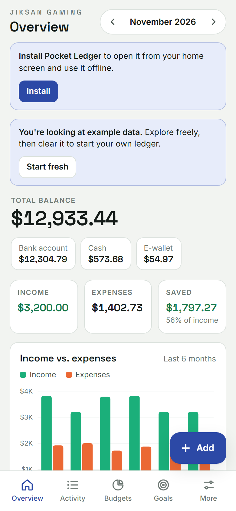

# Pocket Ledger

A simple, private personal finance app. Track income, expenses, budgets, savings goals, accounts and recurring bills, all in one place.

**Open the app:** https://jiksan-pemancing.github.io/pocket-ledger/



## Features

- **Overview:** total balance across accounts, this month's income, expenses and savings, plus a 6-month chart.
- **Activity:** every entry grouped by day, with search and filters by type and category.
- **Budgets:** a monthly limit per category, with warnings when you're close or over.
- **Goals:** savings goals with target dates and a monthly amount to reach each one.
- **Accounts and transfers:** bank, cash, e-wallet and credit card balances.
- **Recurring entries:** salary, rent and subscriptions are added automatically on their dates.
- **Currencies:** IDR, USD, EUR and 12 more. Amounts are not converted.
- **Light and dark mode.**
- **PIN lock:** optional 4 to 6 digit PIN, with auto-lock and a wait after wrong tries.
- **Backup and export:** save a JSON backup, restore it, or export CSV for spreadsheets.

## Install on your phone

1. Open the link above in **Chrome** (Android) or **Safari** (iPhone).
2. Tap **Install** from the banner, or use the browser menu and choose **Install app** / **Add to Home screen**.
3. Open **Pocket Ledger** from your home screen. It works offline after the first load.

## Privacy

- Everything you enter is stored only in your browser on your device.
- Nothing is uploaded and there are no accounts, ads or trackers.
- The only outside request is Google Fonts, which loads the typefaces.
- Export a backup regularly. Clearing browser data or uninstalling the app erases the data.

## Run it on your computer

No build step is needed. Serve the folder with any static web server, for example:

```bash
python -m http.server 8000
```

Then open http://localhost:8000. Some features (PIN lock, install, offline) need HTTPS or localhost.

## Files

| File | Purpose |
| --- | --- |
| `index.html` | The whole app: layout, styles and logic |
| `manifest.webmanifest` | Name, icons and colors for installing the app |
| `sw.js` | Service worker that makes the app work offline |
| `icons/` | App icons |

## License

MIT. See [LICENSE](LICENSE).
